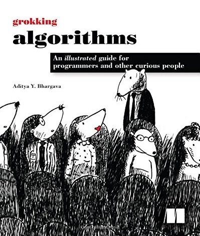
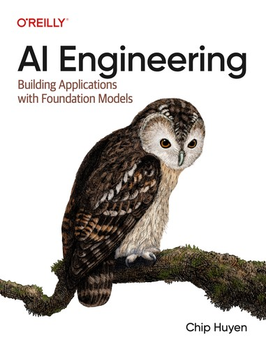
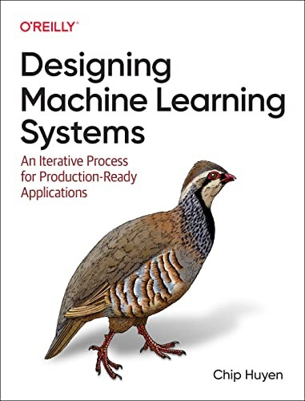

# Books

[← Back to the roadmap](README.md#roadmap)

The books I read along the roadmap. I read each chapter at the level where I practice its topic, not before. Open a phase to see what to read at each level.

|  |  |  |
|:---:|:---:|:---:|
| **Grokking Algorithms** (1st edition) Aditya Y. Bhargava | **AI Engineering** Chip Huyen | **Designing Machine Learning Systems** Chip Huyen |
| algorithms and data structures | building applications with LLMs | machine learning in production |

<b>Phase 1 — Python foundations</b> · Grokking Algorithms

Read on my own at the end of Phase 1. These topics have no exercise levels: the book is how I learn them.

<table>
<tr><th>Topic</th><th>Chapter</th><th>What it covers</th><th>Read</th></tr>
<tr><td>Recursion</td><td align="center">3</td><td>recursion and the call stack</td><td align="center">⬜</td></tr>
<tr><td rowspan="5">Algorithms</td><td align="center">1</td><td>binary search and Big O</td><td align="center">⬜</td></tr>
<tr><td align="center">2</td><td>selection sort, arrays vs. linked lists</td><td align="center">⬜</td></tr>
<tr><td align="center">4</td><td>quicksort, divide and conquer</td><td align="center">⬜</td></tr>
<tr><td align="center">8</td><td>greedy algorithms, NP-complete problems</td><td align="center">⬜</td></tr>
<tr><td align="center">9</td><td>dynamic programming</td><td align="center">⬜</td></tr>
<tr><td rowspan="2">Classic data structures</td><td align="center">5</td><td>hash tables: how dictionaries work inside</td><td align="center">⬜</td></tr>
<tr><td align="center">11</td><td>where to go next: trees and more</td><td align="center">⬜</td></tr>
<tr><td rowspan="2">Graphs</td><td align="center">6</td><td>graphs, breadth-first search</td><td align="center">⬜</td></tr>
<tr><td align="center">7</td><td>Dijkstra's algorithm</td><td align="center">⬜</td></tr>
</table>

<b>Phase 3 — My first AI</b> · AI Engineering

<table>
<tr><th>Level</th><th>Chapter</th><th>Topic</th><th>Read</th></tr>
<tr><td rowspan="2">12 · APIs and my first AI</td><td align="center">1</td><td>what AI engineering is (good any time)</td><td align="center">⬜</td></tr>
<tr><td align="center">5</td><td>prompt engineering</td><td align="center">⬜</td></tr>
</table>

<b>Phase 6 — AI in processes</b> · AI Engineering

<table>
<tr><th>Level</th><th>Chapter</th><th>Topic</th><th>Read</th></tr>
<tr><td>24 · LLMs in practice</td><td align="center">2</td><td>how foundation models work</td><td align="center">⬜</td></tr>
<tr><td>25 · Agents and RAG</td><td align="center">6</td><td>RAG and agents</td><td align="center">⬜</td></tr>
<tr><td rowspan="4">26 · LLMs in production</td><td align="center">3</td><td>evaluation methodology</td><td align="center">⬜</td></tr>
<tr><td align="center">4</td><td>evaluating AI systems</td><td align="center">⬜</td></tr>
<tr><td align="center">9</td><td>inference optimization</td><td align="center">⬜</td></tr>
<tr><td align="center">10</td><td>AI engineering architecture and user feedback</td><td align="center">⬜</td></tr>
</table>

<b>Phase 7 — Machine Learning</b> · Designing Machine Learning Systems, plus one chapter of Grokking Algorithms

<table>
<tr><th>Level</th><th>Chapter</th><th>Topic</th><th>Read</th></tr>
<tr><td rowspan="6">27 · ML foundations</td><td align="center">10</td><td>k-nearest neighbors <i>(Grokking Algorithms)</i></td><td align="center">⬜</td></tr>
<tr><td align="center">1</td><td>overview of ML systems</td><td align="center">⬜</td></tr>
<tr><td align="center">2</td><td>ML systems design</td><td align="center">⬜</td></tr>
<tr><td align="center">3</td><td>data engineering fundamentals</td><td align="center">⬜</td></tr>
<tr><td align="center">4</td><td>training data</td><td align="center">⬜</td></tr>
<tr><td align="center">5</td><td>feature engineering</td><td align="center">⬜</td></tr>
<tr><td>28 · Gradient boosting</td><td align="center">6</td><td>model development and offline evaluation</td><td align="center">⬜</td></tr>
</table>

<b>Phase 8 — Deep Learning</b> · AI Engineering

<table>
<tr><th>Level</th><th>Chapter</th><th>Topic</th><th>Read</th></tr>
<tr><td rowspan="2">32 · Transformers &amp; Hugging Face</td><td align="center">7</td><td>finetuning</td><td align="center">⬜</td></tr>
<tr><td align="center">8</td><td>dataset engineering</td><td align="center">⬜</td></tr>
</table>

<b>Phase 9 — ML Engineering</b> · Designing Machine Learning Systems

<table>
<tr><th>Level</th><th>Chapter</th><th>Topic</th><th>Read</th></tr>
<tr><td>34 · Serve a model</td><td align="center">7</td><td>model deployment</td><td align="center">⬜</td></tr>
<tr><td rowspan="4">35 · Cloud &amp; MLOps</td><td align="center">8</td><td>data distribution shifts and monitoring</td><td align="center">⬜</td></tr>
<tr><td align="center">9</td><td>continual learning and testing in production</td><td align="center">⬜</td></tr>
<tr><td align="center">10</td><td>infrastructure and tooling for MLOps</td><td align="center">⬜</td></tr>
<tr><td align="center">11</td><td>the human side of ML</td><td align="center">⬜</td></tr>
</table>

