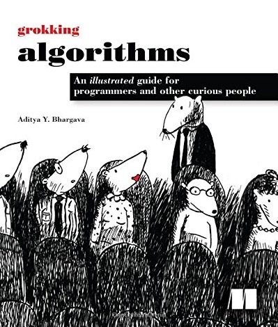
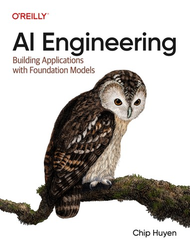
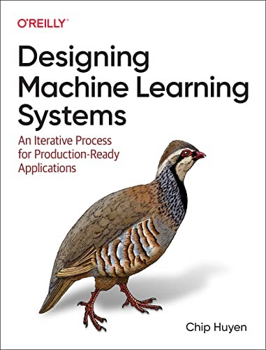

# AI-Journey 🧠

My journey to becoming an AI engineer: a roadmap made with [Claude](https://claude.com/claude-code) that starts with the basics of Python and goes all the way to automation, Machine Learning and AI applied to real processes. Python is the language of the whole journey.

Some exercises are inspired by beecrowd: each one has a problem statement, input/output descriptions and sample cases. From Phase 4 on, it is **more projects than exercises**.

Claude only writes the exercise statements and project briefs. It never writes my solutions, and only shows an answer if I ask for it after really trying. All the code, pipelines and algorithms are written by me. When I get stuck, Claude gives hints, explains concepts and errors, and reviews my code after I solve it.

## Tech stack

The technologies this roadmap covers (hover over a logo to see its name):

| Area | Technologies |
|---|---|
| **Language & tools** | &nbsp;&nbsp;&nbsp;&nbsp;&nbsp;&nbsp;&nbsp;&nbsp;&nbsp; |
| **AI & LLMs** | &nbsp;&nbsp;&nbsp; |
| **Data** | &nbsp;&nbsp;&nbsp;&nbsp;&nbsp;&nbsp; |
| **Machine Learning** | &nbsp; |
| **Production** | &nbsp;&nbsp;&nbsp; |

## Books

|  |  |  |
|:---:|:---:|:---:|
| **Grokking Algorithms** (1st edition) Aditya Y. Bhargava | **AI Engineering** Chip Huyen | **Designing Machine Learning Systems** Chip Huyen |
| algorithms and data structures | building applications with LLMs | machine learning in production |

📖 **[Reading plan](BOOKS.md)**: the books I study with and the chapters for each level.

## Roadmap

The goal: **improve real processes with Python and AI, and grow toward AI or Machine Learning Engineering**. The journey is split into phases, and each phase ends with a **project** for my portfolio.

| Phase | Focus | Project | Status |
|---|---|---|---|
| [1 — Python foundations](01-python-foundations/) | the language itself: syntax, data, functions, modules, recursion, algorithms, files, OOP, data structures, graphs | expense tracker (CLI) | 🟢 in progress |
| 2 — Tools & good practices | the tools professionals use: `venv` and `uv`, Git and teamwork, tests, logging, Ruff, type checking, CI | tested, packaged project | ⚪ Locked |
| 3 — My first AI | call an LLM from Python | terminal chatbot | ⚪ Locked |
| 4 — Automation | make Python do repetitive work | a manual report, automated | ⚪ Locked |
| 5 — Data analysis | turn data into insight: SQL, math for ML, pandas, data pipelines, stats, dashboards | data dashboard | ⚪ Locked |
| 6 — AI in processes | LLMs that read documents, act and run reliably in production | document-reading assistant | ⚪ Locked |
| 7 — Machine Learning | train and properly evaluate models (scikit-learn, XGBoost), optimize real processes | well-evaluated prediction model | ⚪ Locked |
| 8 — Deep Learning | PyTorch, computer vision, transformers, reinforcement learning | a fine-tuned model vs. an LLM | ⚪ Locked |
| 9 — ML Engineering | put a model in production (FastAPI, Docker, AWS, MLflow) | a deployed model with an API & monitoring | ⚪ Locked |
| Final | everything together | end-to-end AI automation | ⚪ Locked |

Each phase below opens with the details. The 📖 column shows which book chapters go with each level: click it to see the chapters in [BOOKS.md](BOOKS.md).

<b>Phase 1 — Python foundations</b>

&nbsp;

| Level | Topic | What you will learn | 📖 Book |
|---|---|---|---|
| 01 | [Fundamentals](01-python-foundations/#level-01-fundamentals) ✅ | `print`, `input`, variables, types, `if`, `for`, `while`, `//` and `%`, `range` with steps, nested loops, `break` and `continue`, input validation |  |
| 02 | [Strings](01-python-foundations/#level-02-strings) | quotes and escapes, raw and multi-line strings, `len`, indexing, slicing, immutability, methods (case, `is...`, `find`, `strip`, `replace`, `split`, `join`, `partition`...), comparing text, `ord`/`chr` and Unicode, formatting (alignment, separators, percentages), parsing text and log files |  |
| 03 | Data structures | lists (indexing and slicing like strings, `append`, `insert`, `remove`, `pop`, `sort` vs `sorted`, `min`/`max`/`sum`), mutability and copies (why changing one list can change another), lists of lists (grids and tables), tuples and unpacking, dictionaries (keys and values, `.get()`, looping with `.items()`, counting and grouping), sets (removing duplicates, fast `in`, union and intersection), nested data (a list of dictionaries: the shape of JSON), `enumerate` and `zip`, comprehensions (list, dict and set) |  |
| 04 | Functions | `def`, parameters (default values, keyword arguments), return values (returning several at once), scope (local vs global), docstrings, `lambda` and `sorted(key=...)`, `map` and `filter`, `*args`/`**kwargs`, type hints |  |
| 05 | Modules and the standard library | `import` and the standard library (`math`, `random`, `string`, `datetime` for dates, `decimal` for money), splitting your code across files (your own modules), `if __name__ == "__main__"`, reading command-line arguments with `sys.argv`, your first `pip install`, your first tests with `pytest` (a test file, `assert`, running `pytest`). Mini-project: an ASCII-art banner generator for the terminal (`pyfiglet` + `rich`: fonts, colors, panels, validated prompts, save to `.txt`) |  |
| 06 | Recursion | the base case, how the call stack works, factorial, Fibonacci, Tower of Hanoi, recursion vs loops (and Python's recursion limit) | [Grokking ch. 3](BOOKS.md) |
| 07 | Algorithms | searching, sorting, the Sieve of Eratosthenes (all primes up to N at once), Big O (how fast code is), number bases (binary and hexadecimal, converting by hand), greedy algorithms (and NP-complete problems: why some problems have no known fast solution), dynamic programming, interview-style coding practice (keep practicing through the later phases) | [Grokking ch. 1, 2, 4, 8, 9](BOOKS.md) |
| 08 | Files and errors | reading/writing files, `pathlib` (file paths that work on any computer), CSV, JSON, `try`/`except`, raising errors with `raise` and creating your own exceptions, text encodings (UTF-8 vs Windows-1252, the reason `ç` sometimes shows up as `ç`), regular expressions (`re`) to find and clean patterns in text, removing accents (`unicodedata`) |  |
| 09 | Object-oriented programming | classes, objects, class variables (shared by all objects), inheritance, `__str__` and `__repr__` (how your objects turn into text), operator overloading (`__add__`, `__eq__`: making `+` and `==` work with your objects) |  |
| 10 | Classic data structures | stacks and queues (`collections.deque`), linked lists, hash tables (how dictionaries work inside: hashing and collisions), trees and binary search trees, heaps and priority queues (`heapq`): building them with your own classes, and choosing the right one for each problem (with Big O) | [Grokking ch. 5, 11](BOOKS.md) |
| 11 | Graphs | graph theory basics (vertices and edges, directed and weighted graphs, paths, cycles, connected components), storing a graph in a dictionary, walking it with BFS and DFS, shortest paths (Dijkstra), the cheapest way to connect everything (minimum spanning tree), putting tasks in the right order (topological sort, like the steps of a process) | [Grokking ch. 6, 7](BOOKS.md) |
| 12 | Iterators, generators and decorators | how `for` really works (`iter()` and `next()`), generators (`yield`: reading huge files without running out of memory), decorators (functions that wrap other functions, `@property`, `@staticmethod`, `@classmethod`) |  |

🎯 **Project:** a command-line expense tracker — add expenses, save them to a file, show totals and the biggest ones. The code is split into modules, and you run it with commands like `python tracker.py add 12.50 food` or `python tracker.py report` (`argparse`). (You'll analyze this same data in Phase 5.)

<b>Phase 2 — Tools & good practices</b>

&nbsp;&nbsp;&nbsp;&nbsp;&nbsp;&nbsp;

| Level | Topic | What you will learn |
|---|---|---|
| 13 | Tools | `pip`, virtual environments (`venv`), then `uv` (packages, virtual environments and the project file `pyproject.toml` in one fast tool), logging, the debugger, the Linux terminal (WSL), SSH basics (practiced for free inside WSL), API keys and secrets (environment variables, `.env` files, `.gitignore`, what to do if a key leaks) |
| 14 | Code quality | advanced tests with `pytest` (`parametrize`, fixtures, coverage), linting and formatting with Ruff, type checking with `mypy`, CI with GitHub Actions |
| 15 | Git and teamwork | branches, pull requests, code reviews, reading other people's code, contributing to an open-source project |

🎯 **Project:** turn the expense tracker into a real project — managed with `uv` (`pyproject.toml`), tests with `pytest`, and a clean Git history.

<b>Phase 3 — My first AI</b>

&nbsp;

| Level | Topic | What you will learn | 📖 Book |
|---|---|---|---|
| 16 | APIs and my first AI | HTTP, `requests`, JSON, calling an LLM API, writing prompts, getting structured (JSON) answers, validating data with Pydantic, async Python (`async`/`await`), a first try with an open-source AI agent: give it small tasks in WSL and watch which tools it uses and what each task costs | [AI Engineering ch. 1, 5](BOOKS.md) |

🎯 **Project:** a terminal chatbot that remembers the conversation.

<b>Phase 4 — Automation</b>

| Level | Topic | What you will learn |
|---|---|---|
| 17 | Office automation | process improvement basics (mapping a process, measuring it before changing it, finding the bottleneck), Excel (`openpyxl`), PDF (`pypdf` to merge, split and read simple text, `pdfplumber` to pull out tables), e-mail, scheduling scripts to run on their own |
| 18 | Web automation | consuming public APIs, HTML basics (tags and CSS selectors), basic web scraping |

🎯 **Project:** a report that is done by hand today, generated on its own.

<b>Phase 5 — Data analysis</b>

&nbsp;&nbsp;&nbsp;&nbsp;&nbsp;&nbsp;

| Level | Topic | What you will learn |
|---|---|---|
| 19 | SQL | PostgreSQL, `SELECT`, `JOIN`, aggregations |
| 20 | NumPy & linear algebra | arrays, vectors and matrices — the math behind ML |
| 21 | Calculus for ML | derivatives and the gradient idea |
| 22 | Probability | chance, distributions, conditional probability |
| 23 | Pandas and charts | Jupyter notebooks (in VS Code), data tables, filtering, grouping, Matplotlib and Seaborn |
| 24 | Data pipelines | cleaning messy data, data validation, scheduled pipelines |
| 25 | Statistics and dashboards | mean, variation, control charts, confidence intervals, hypothesis tests, A/B tests (to prove one model or prompt is really better), dashboards with Streamlit |

🎯 **Project:** a dashboard with a process's indicators (time, bottlenecks, errors).

<b>Phase 6 — AI in processes</b>

&nbsp;&nbsp;&nbsp;

| Level | Topic | What you will learn | 📖 Book |
|---|---|---|---|
| 26 | LLMs in practice | classify text, extract data from documents, structured output, measuring cost and response time | [AI Engineering ch. 2](BOOKS.md) |
| 27 | Agents and RAG | AI that runs tasks and reads internal documents to answer, tool use (build your own agent loop first: the LLM asks for a tool, your code runs it and sends back the result), agent frameworks, MCP (the standard way to connect an AI to tools), writing your own skills for an agent, embeddings and vector databases (Chroma to start, then pgvector inside PostgreSQL), AI safety and security (prompt injection, data leaks, unsafe agent actions) | [AI Engineering ch. 6](BOOKS.md) |
| 28 | LLMs in production | a basic API for your LLM app with FastAPI, streaming, caching, rate limits, fallbacks, tracing what the app did, evaluating LLM apps (a test set of real examples, scoring the answers automatically, catching what gets worse when you change a prompt or a model) | [AI Engineering ch. 3, 4, 9, 10](BOOKS.md) |

🎯 **Project:** an assistant that reads e-mails or documents and fills a spreadsheet: an AI agent running skills you write yourself.

<b>Phase 7 — Machine Learning</b>

| Level | Topic | What you will learn | 📖 Book |
|---|---|---|---|
| 29 | ML foundations | scikit-learn: classic models (k-nearest neighbors, linear and logistic regression, decision trees), train/test split, cross-validation, overfitting, feature engineering, choosing the right metric, unsupervised learning (finding groups with clustering, simplifying data with PCA) | [Grokking ch. 10, Designing ML Systems ch. 1–5](BOOKS.md) |
| 30 | Gradient boosting | XGBoost and LightGBM — the models that win most real tabular problems | [Designing ML Systems ch. 6](BOOKS.md) |
| 31 | Optimization with AI | combinatorial problems (knapsack, scheduling, routing: the traveling salesman), heuristics that find good answers fast (genetic algorithms, simulated annealing), and solvers (Google OR-Tools) that find the best schedule or route for a real process |  |

🎯 **Project:** a prediction model (e.g. process delays) that is trained and **properly evaluated**, not just `.fit()`.

<b>Phase 8 — Deep Learning</b>

&nbsp;

| Level | Topic | What you will learn | 📖 Book |
|---|---|---|---|
| 32 | Neural networks | PyTorch: tensors, autograd, build and train your own network on a free GPU (Google Colab or Kaggle) |  |
| 33 | Computer vision | image basics first (an image is a NumPy array of pixels, filters, edge detection, OpenCV), then CNNs: teach a model to recognize images |  |
| 34 | Transformers & Hugging Face | attention, embeddings, using and fine-tuning pretrained models (LoRA) | [AI Engineering ch. 7, 8](BOOKS.md) |
| 35 | Reinforcement learning | an agent that learns by trial and error (Gymnasium, Stable-Baselines3). Mini-project: the **red-ball agent**, an AI that learns to reach a random target as fast as it can |  |

🎯 **Project:** fine-tune a Hugging Face model to sort customer-support messages into categories, using a **public dataset** (no private or company data), and compare it with the Phase 6 LLM approach: accuracy, cost and speed.

<b>Phase 9 — ML Engineering</b>

&nbsp;&nbsp;&nbsp;&nbsp;

| Level | Topic | What you will learn | 📖 Book |
|---|---|---|---|
| 36 | Serve a model | wrap a model in a FastAPI API, connect it to PostgreSQL and package it with Docker | [Designing ML Systems ch. 7](BOOKS.md) |
| 37 | Cloud & MLOps | deploy to AWS (using the free plan credits), keep an AI agent running 24/7 on a free cloud server (AWS free plan) safely, track experiments with MLflow, monitor the model, system design interview practice | [Designing ML Systems ch. 8–11](BOOKS.md) |

🎯 **Project:** a model of mine **live on the internet**, with an API and basic monitoring.

<b>Final project</b>

A complete AI automation, end to end, with the **before and after measured**, used by **a real person** other than me.

