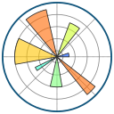
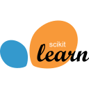

# Python-Journey 🐍

A Python roadmap made with [Claude](https://claude.com/claude-code) to study Python from basics all the way to automation and artificial intelligence applied to real processes. 

Some exercises are inspired by beecrowd: each one has a problem statement, input/output descriptions and sample cases. From Level 04 on, it is **more projects than exercises**.

Claude only writes the exercise statements and project briefs. It never writes my solutions, and only shows an answer if I ask for it after really trying. All the code, pipelines and algorithms are written by me. When I get stuck, Claude gives hints, explains concepts and errors, and reviews my code after I solve it.

To build pipelines, algorithms and solve mathematical problems, I will use [Excalidraw](https://excalidraw.com/)&nbsp;&nbsp;

## Tech stack

The technologies this roadmap covers (hover over a logo to see its name):

| Area | Technologies |
|---|---|
| **Language & tools** | &nbsp;&nbsp;&nbsp;&nbsp;&nbsp;&nbsp;&nbsp; |
| **AI & LLMs** | &nbsp;&nbsp; |
| **Data** | &nbsp;&nbsp;&nbsp;&nbsp;&nbsp; |
| **Machine Learning** | &nbsp; |
| **Production** | &nbsp;&nbsp;&nbsp; |

## Roadmap

The goal: **improve real processes with Python and AI, and grow toward AI or Machine Learning Engineering**. The journey is split into phases, and each phase ends with a **project** for my portfolio.

| Phase | Focus | Project | Status |
|---|---|---|---|
| [1 — Python foundations](01-python-foundations/) | the language itself: syntax, data, functions, recursion, algorithms, files, OOP | expense tracker (CLI) | 🟢 in progress |
| 2 — Tools & good practices | the tools professionals use: `venv`, Git and teamwork, tests, logging, Ruff, type checking, CI | tested, packaged project | ⚪ Locked |
| 3 — My first AI | call an LLM from Python | terminal chatbot | ⚪ Locked |
| 4 — Automation | make Python do repetitive work | a manual report, automated | ⚪ Locked |
| 5 — Data analysis | turn data into insight: SQL, math for ML, pandas, data pipelines, stats, dashboards | data dashboard | ⚪ Locked |
| 6 — AI in processes | LLMs that read documents, act and run reliably in production | document-reading assistant | ⚪ Locked |
| 7 — Machine Learning | train and properly evaluate models (scikit-learn, XGBoost) | well-evaluated prediction model | ⚪ Locked |
| 8 — Deep Learning | PyTorch, computer vision, transformers, reinforcement learning | a fine-tuned model vs. an LLM | ⚪ Locked |
| 9 — ML Engineering | put a model in production (FastAPI, Docker, AWS, MLflow) | a deployed model with an API & monitoring | ⚪ Locked |
| Final | everything together | end-to-end AI automation | ⚪ Locked |

Each phase below opens with the details.

<b>Phase 1 — Python foundations</b>

&nbsp;

| Level | Topic | What you will learn |
|---|---|---|
| 01 | [Fundamentals](01-python-foundations/01-fundamentals/) | `print`, `input`, variables, types, `if`, `for`, `while`, `//` and `%`, `range` with steps, nested loops, `break` and `continue`, input validation |
| 02 | Strings | concatenation, indexing, slicing, methods (`split`, `join`, `replace`...), formatting, immutability |
| 03 | Data structures | lists, tuples, dictionaries, sets, comprehensions |
| 04 | Functions and recursion | `def`, parameters, return values, scope, `import`, `lambda`, `*args`/`**kwargs`, generators, decorators, type hints, and recursion: factorial, Fibonacci, Tower of Hanoi. Mini-project: an ASCII-art banner generator for the terminal (`pyfiglet` + `rich`: fonts, colors, panels, validated prompts, save to `.txt`) |
| 05 | Algorithms | searching, sorting, the Sieve of Eratosthenes (all primes up to N at once), Big O (how fast code is), greedy algorithms and dynamic programming, interview-style coding practice (keep practicing through the later phases) |
| 06 | Files and errors | reading/writing files, CSV, JSON, `try`/`except` |
| 07 | Object-oriented programming | classes, objects, inheritance |

🎯 **Project:** a command-line expense tracker — add expenses, save them to a file, show totals and the biggest ones. (You'll analyze this same data in Phase 5.)

<b>Phase 2 — Tools & good practices</b>

&nbsp;&nbsp;&nbsp;&nbsp;&nbsp;

| Level | Topic | What you will learn |
|---|---|---|
| 08 | Tools | `pip`, virtual environments (`venv`), logging, the debugger, the Linux terminal (WSL) |
| 09 | Code quality | tests with `pytest`, linting and formatting with Ruff, type checking with `mypy`, CI with GitHub Actions |
| 10 | Git and teamwork | branches, pull requests, code reviews, reading other people's code, contributing to an open-source project |

🎯 **Project:** turn the expense tracker into a real project — a virtual environment, tests with `pytest`, and a clean Git history.

<b>Phase 3 — My first AI</b>

&nbsp;

| Level | Topic | What you will learn |
|---|---|---|
| 11 | APIs and my first AI | HTTP, `requests`, JSON, calling an LLM API, writing prompts, getting structured (JSON) answers, validating data with Pydantic, async Python (`async`/`await`) |

🎯 **Project:** a terminal chatbot that remembers the conversation.

<b>Phase 4 — Automation</b>

| Level | Topic | What you will learn |
|---|---|---|
| 12 | Office automation | Excel (`openpyxl`), PDF, e-mail, scheduling scripts to run on their own |
| 13 | Web automation | consuming public APIs, basic web scraping |

🎯 **Project:** a report that is done by hand today, generated on its own.

<b>Phase 5 — Data analysis</b>

&nbsp;&nbsp;&nbsp;&nbsp;&nbsp;

| Level | Topic | What you will learn |
|---|---|---|
| 14 | SQL | PostgreSQL, `SELECT`, `JOIN`, aggregations |
| 15 | NumPy & linear algebra | arrays, vectors and matrices — the math behind ML |
| 16 | Calculus for ML | derivatives and the gradient idea |
| 17 | Probability | chance, distributions, conditional probability |
| 18 | Pandas and charts | data tables, filtering, grouping, Matplotlib and Seaborn |
| 19 | Data pipelines | cleaning messy data, data validation, scheduled pipelines |
| 20 | Statistics and dashboards | mean, variation, control charts, confidence intervals, hypothesis tests, A/B tests (to prove one model or prompt is really better), dashboards with Streamlit |

🎯 **Project:** a dashboard with a process's indicators (time, bottlenecks, errors).

<b>Phase 6 — AI in processes</b>

&nbsp;

| Level | Topic | What you will learn |
|---|---|---|
| 21 | LLMs in practice | classify text, extract data from documents, structured output, measuring cost and response time |
| 22 | Agents and RAG | AI that runs tasks and reads internal documents to answer, embeddings and vector databases (Chroma to start, then pgvector inside PostgreSQL), evaluating LLM apps, AI safety and security (prompt injection, data leaks, unsafe agent actions) |
| 23 | LLMs in production | streaming, caching, rate limits, fallbacks, tracing what the app did |

🎯 **Project:** an assistant that reads e-mails or documents and fills a spreadsheet.

<b>Phase 7 — Machine Learning</b>

| Level | Topic | What you will learn |
|---|---|---|
| 24 | ML foundations | scikit-learn: train/test split, cross-validation, overfitting, feature engineering, choosing the right metric |
| 25 | Gradient boosting | XGBoost and LightGBM — the models that win most real tabular problems |

🎯 **Project:** a prediction model (e.g. process delays) that is trained and **properly evaluated**, not just `.fit()`.

<b>Phase 8 — Deep Learning</b>

&nbsp;

| Level | Topic | What you will learn |
|---|---|---|
| 26 | Neural networks | PyTorch: tensors, autograd, build and train your own network |
| 27 | Computer vision | CNNs: teach a model to recognize images |
| 28 | Transformers & Hugging Face | attention, embeddings, using and fine-tuning pretrained models (LoRA) |
| 29 | Reinforcement learning | an agent that learns by trial and error (Gymnasium, Stable-Baselines3). Mini-project: the **red-ball agent**, an AI that learns to reach a random target as fast as it can |

🎯 **Project:** fine-tune a Hugging Face model to sort customer-support messages into categories, using a **public dataset** (no private or company data), and compare it with the Phase 6 LLM approach: accuracy, cost and speed.

<b>Phase 9 — ML Engineering</b>

&nbsp;&nbsp;&nbsp;&nbsp;

| Level | Topic | What you will learn |
|---|---|---|
| 30 | Serve a model | wrap a model in a FastAPI API, connect it to PostgreSQL and package it with Docker |
| 31 | Cloud & MLOps | deploy to AWS (using the free plan credits), track experiments with MLflow, monitor the model, system design interview practice |

🎯 **Project:** a model of mine **live on the internet**, with an API and basic monitoring.

<b>Final project</b>

A complete AI automation, end to end, with the **before and after measured**, used by **a real person** other than me.

