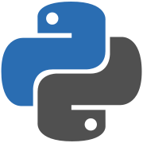

# AI-Journey 🧠

My journey to becoming an AI engineer: a roadmap made with [Claude](https://claude.com/claude-code) that starts with the basics of Python and goes all the way to automation, Machine Learning and AI applied to real processes. Python is the language of the whole journey.

Some exercises are inspired by beecrowd: each one has a problem statement, input/output descriptions and sample cases. From Phase 4 on, it is **more projects than exercises**.

The goal is to become an **AI engineer who uses AI to develop**: someone who understands the code, builds real projects from start to finish, and works well with AI. That means using AI to move faster, but reading and reviewing every piece of code it generates before trusting it: does it really work, is it safe, and is there a simpler way?

## Tech stack

The technologies this roadmap covers (hover over a logo to see its name):

| Area | Technologies |
|---|---|
| **Language & tools** | &nbsp;&nbsp;&nbsp;&nbsp;&nbsp;&nbsp;&nbsp;&nbsp;&nbsp;&nbsp;&nbsp; |
| **AI & LLMs** | &nbsp;&nbsp;&nbsp; |
| **Data** | &nbsp;&nbsp;&nbsp;&nbsp;&nbsp;&nbsp;&nbsp; |
| **Machine Learning** | &nbsp;&nbsp;&nbsp; |
| **Production** | &nbsp;&nbsp;&nbsp; |

## Roadmap

The goal: **improve real processes with Python and AI, and grow toward AI or Machine Learning Engineering**. The journey is split into phases, and each phase ends with a **project** for my portfolio.

| Phase | Focus | Project | Status |
|---|---|---|---|
| [1 — Python foundations](01-python-foundations/) | the language itself: syntax, data, functions, modules, recursion, algorithms, files, SQL basics, OOP, data structures, graphs | expense tracker (CLI + SQLite) | 🟢 in progress |
| 2 — Tools & good practices | the tools professionals use: `venv` and `uv`, Git and teamwork, tests, logging, Ruff, type checking, CI | tested, packaged project | ⚪ Locked |
| 3 — My first AI | call an LLM from Python | terminal chatbot | ⚪ Locked |
| 4 — Automation | make Python do repetitive work: process improvement, pandas, Excel, PDFs and e-mails, web automation, data pipelines | a manual report, automated | ⚪ Locked |
| 5 — Data analysis | turn data into insight: SQL, math for ML, statistics, process analytics, dashboards | data dashboard | ⚪ Locked |
| 6 — AI in processes | LLMs that read documents, act and run reliably in production | document-reading assistant | ⚪ Locked |
| 7 — Machine Learning | train and properly evaluate models (scikit-learn, XGBoost), optimize real processes | well-evaluated prediction model | ⚪ Locked |
| 8 — Deep Learning | PyTorch, computer vision, transformers, reinforcement learning | a fine-tuned model vs. an LLM | ⚪ Locked |
| 9 — ML Engineering | put a model in production (FastAPI, Docker, AWS, MLflow) | a deployed model with an API & monitoring | ⚪ Locked |
| Final | everything together | end-to-end AI automation | ⚪ Locked |

Each phase below opens with the details. The 📖 column shows which book chapters go with each level: click it to see the chapters in [BOOKS.md](BOOKS.md).

<b>Phase 1 — Python foundations</b>

&nbsp;&nbsp;

| Level | Topic | What you will learn | 📖 Book |
|---|---|---|---|
| 01 | [Fundamentals](01-python-foundations/#level-01-fundamentals) ✅ | `print`, `input`, variables, types, `if`, `for`, `while`, `//` and `%`, `range` with steps, nested loops, `break` and `continue`, input validation |  |
| 02 | [Strings](01-python-foundations/#level-02-strings) | quotes and escapes, raw and multi-line strings, `len`, indexing, slicing, immutability, methods (case, `is...`, `find`, `strip`, `replace`, `split`, `join`, `partition`...), comparing text, `ord`/`chr` and Unicode, formatting (alignment, separators, percentages), parsing text and log files |  |
| 03 | Data structures | lists (indexing and slicing like strings, `append`, `insert`, `remove`, `pop`, `sort` vs `sorted`, `min`/`max`/`sum`), mutability and copies (why changing one list can change another), lists of lists (grids and tables), tuples and unpacking, dictionaries (keys and values, `.get()`, looping with `.items()`, counting and grouping), sets (removing duplicates, fast `in`, union and intersection), nested data (a list of dictionaries: the shape of JSON), `enumerate` and `zip`, comprehensions (list, dict and set) |  |
| 04 | Functions | `def`, parameters (default values, keyword arguments), return values (returning several at once), scope (local vs global), docstrings, `lambda` and `sorted(key=...)`, `map` and `filter`, `*args`/`**kwargs`, type hints |  |
| 05 | Modules and the standard library | `import` and the standard library (`math`, `random`, `string`, `datetime` for dates, `decimal` for money), splitting your code across files (your own modules), `if __name__ == "__main__"`, reading command-line arguments with `sys.argv`, fast input with `sys.stdin.readline` (for very big inputs), your first `pip install`, your first tests with `pytest` (a test file, `assert`, running `pytest`). Mini-project: an ASCII-art banner generator for the terminal (`pyfiglet` + `rich`: fonts, colors, panels, validated prompts, save to `.txt`) |  |
| 06 | Recursion | the base case, how the call stack works, factorial, Fibonacci, Tower of Hanoi, GCD with Euclid's algorithm, recursion vs loops (and Python's recursion limit) | [Grokking ch. 3](BOOKS.md) |
| 07 | Algorithms | searching, sorting, binary search, two pointers, prefix sums (the same idea as cumulative sums in pandas), the Sieve of Eratosthenes (all primes up to N at once), fast modular exponentiation (`pow(a, b, m)`), Big O (how fast code is), number bases (binary and hexadecimal, converting by hand), greedy algorithms (and NP-complete problems: why some problems have no known fast solution), dynamic programming, interview-style coding practice (keep practicing through the later phases) | [Grokking ch. 1, 2, 4, 8, 9](BOOKS.md) |
| 08 | Files and errors | reading/writing files, `pathlib` (file paths that work on any computer), CSV, JSON, reading error messages (the traceback: the error type on the last line, the file and line number, then the path of calls that led there) and investigating a bug step by step, `try`/`except`, raising errors with `raise` and creating your own exceptions, text encodings (UTF-8 vs Windows-1252, the reason `ç` sometimes shows up as `ç`), regular expressions (`re`) to find and clean patterns in text, removing accents (`unicodedata`) |  |
| 09 | SQL basics | what a database is (tables, rows and columns, and when it beats a CSV file), SQLite from Python with `sqlite3` (built into Python: nothing to install, the whole database is one file), creating a table (`CREATE TABLE`, column types, a primary key), adding, reading, changing and deleting rows (`INSERT`, `SELECT` with `WHERE` and `ORDER BY`, `UPDATE`, `DELETE`), saving changes with `commit`, passing values safely with `?` placeholders (never with f-strings: that opens the door to SQL injection) |  |
| 10 | Object-oriented programming | classes, objects, class variables (shared by all objects), inheritance, `__str__` and `__repr__` (how your objects turn into text), operator overloading (`__add__`, `__eq__`: making `+` and `==` work with your objects) |  |
| 11 | Classic data structures | stacks and queues (`collections.deque`), linked lists, hash tables (how dictionaries work inside: hashing and collisions), trees and binary search trees, heaps and priority queues (`heapq`): building them with your own classes, and choosing the right one for each problem (with Big O) | [Grokking ch. 5, 11](BOOKS.md) |
| 12 | Graphs | graph theory basics (vertices and edges, directed and weighted graphs, paths, cycles, connected components), storing a graph in a dictionary, walking it with BFS and DFS, shortest paths (Dijkstra), putting tasks in the right order (topological sort, like the steps of a process) | [Grokking ch. 6, 7](BOOKS.md) |
| 13 | Iterators, generators and decorators | how `for` really works (`iter()` and `next()`), generators (`yield`: reading huge files without running out of memory), decorators (functions that wrap other functions, `@property`, `@staticmethod`, `@classmethod`) |  |

🎯 **Project:** a command-line expense tracker — add expenses, save them in a SQLite database, and show totals and the biggest ones with SQL queries (like "how much did I spend on food this month?"). The code is split into modules, and you run it with commands like `python tracker.py add 12.50 food` or `python tracker.py report` (`argparse`). (You'll analyze this same data in Phase 5.)

<b>Phase 2 — Tools & good practices</b>

&nbsp;&nbsp;&nbsp;&nbsp;&nbsp;&nbsp;&nbsp;

| Level | Topic | What you will learn |
|---|---|---|
| 14 | Tools | Git basics (`init`, `status`, `add`, `commit`, `log`, `diff`, undoing mistakes, `push` to GitHub), `pip`, virtual environments (`venv`), then `uv` (packages, virtual environments and the project file `pyproject.toml` in one fast tool), logging, the debugger, the Linux terminal (WSL), SSH basics (practiced for free inside WSL), API keys and secrets (environment variables, `.env` files, `.gitignore`, what to do if a key leaks), working with AI coding assistants (Claude Code, GitHub Copilot): giving context (what you're building, the full error message, what you already tried), asking in small steps instead of "build the whole app", asking it to explain the code before you use it, spotting when it's wrong (functions that don't exist, outdated libraries, code that looks right but fails), and never pasting API keys or private data into it |
| 15 | Code quality | advanced tests with `pytest` (`parametrize`, fixtures, coverage), linting and formatting with Ruff, type checking with `mypy`, CI with GitHub Actions |
| 16 | Git and teamwork | branches, pull requests, code reviews, reading other people's code, reviewing code generated by AI (does it really work, does it handle the edge cases, is it safe, is there a simpler way, test it before trusting it), contributing to an open-source project |

🎯 **Project:** turn the expense tracker into a real project — managed with `uv` (`pyproject.toml`), tests with `pytest`, and a clean Git history.

<b>Phase 3 — My first AI</b>

&nbsp;

| Level | Topic | What you will learn | 📖 Book |
|---|---|---|---|
| 17 | APIs and my first AI | HTTP requests with `requests` (`GET` and `POST`, URL parameters, headers, sending and receiving JSON, status codes like 200, 404 and 500, timeouts and errors), calling an LLM API, writing prompts, getting structured (JSON) answers, validating data with Pydantic, async Python (`async`/`await`), a first try with an open-source AI agent: give it small tasks in WSL and watch which tools it uses and what each task costs | [AI Engineering ch. 1, 5](BOOKS.md) |

🎯 **Project:** a terminal chatbot that remembers the conversation.

<b>Phase 4 — Automation</b>

&nbsp;&nbsp;&nbsp;&nbsp;&nbsp;

| Level | Topic | What you will learn |
|---|---|---|
| 18 | Process improvement | mapping a process step by step (drawn in Excalidraw), measuring it before changing anything (how long it takes, how often it runs, how many errors), finding the bottleneck, Lean basics (the waste in a process: waiting, rework, extra steps), fixing the process before automating it (automating a bad process only makes the mistakes faster), choosing what to automate first (how often × how long × how many errors), picking the right tool (a Python script, or an Excel formula when that's all it takes), calculating the time and money saved, talking to the people who do the work |
| 19 | Pandas and charts | Jupyter notebooks (in VS Code), reading Excel and CSV files (several sheets, messy headers), DataFrames (data tables), selecting and filtering rows, sorting, new columns, grouping and pivot tables, joining two tables with `merge` (like VLOOKUP in Excel), working with dates, writing several sheets to one Excel file, charts with Matplotlib and Seaborn |
| 20 | Office automation | files and folders (copy, move, rename and zip in bulk with `shutil`), Excel formatting and templates (`openpyxl`: colors, column widths, formulas, filling in a company template), Word documents from a template (`python-docx`), PDFs (`pypdf` to merge, split and read simple text, `pdfplumber` to pull out tables, and creating them: an Excel sheet to PDF with `pywin32`, or building one with `fpdf2`), e-mail (sending with attachments using `smtplib` + `email` or classic Outlook with `pywin32`, and saving the attachments of e-mails you receive) |
| 21 | Web automation | consuming APIs (API keys, pagination, rate limits), HTML basics (tags and CSS selectors), web scraping with `BeautifulSoup`, browser automation with Playwright (logging in, filling in forms and downloading files on sites that have no API), scraping politely (`robots.txt`, terms of use, not overloading the site) |
| 22 | Data pipelines | the ETL idea (extract, transform, load), cleaning messy data (missing values, duplicates, wrong types, dates in different formats), data validation (stopping bad data before it reaches the report), keeping the raw files untouched, running on its own (Windows Task Scheduler, or `cron` on Linux), log files and an alert e-mail when a run fails, safe re-runs (running twice doesn't duplicate the data), settings in a config file instead of paths written in the code, a README so a colleague can run it without you |

🎯 **Project:** a report that is done by hand today, generated on its own: it reads the data, builds the report, saves it as a PDF, e-mails it and runs on a schedule, with the **time saved measured** (before vs. after). The repo is public, so it runs on fake data with the same columns as the real one.

<b>Phase 5 — Data analysis</b>

&nbsp;&nbsp;

| Level | Topic | What you will learn |
|---|---|---|
| 23 | SQL for analysis | PostgreSQL (the SQL from Level 09, now on a real database server), `JOIN` (inner and left), aggregations with `GROUP BY` and `HAVING`, `CASE WHEN`, `NULL` values, dates, subqueries and CTEs (`WITH`), window functions (rankings, running totals, comparing a row with the previous one), keys and indexes (why some queries are slow), designing tables, running SQL from Python (`psycopg`, `pd.read_sql`) |
| 24 | NumPy & linear algebra | arrays, math on whole arrays without loops (vectorization and broadcasting), vectors and matrices, the dot product and cosine similarity (how embeddings are compared in Phase 6), matrix multiplication — the math behind ML |
| 25 | Calculus for ML | derivatives and the gradient idea, gradient descent written by hand in NumPy (how a model learns) |
| 26 | Probability | counting (permutations and combinations with `math.perm` and `math.comb`: how many ways something can happen), chance, distributions (normal, binomial, and Poisson for things like arrivals per hour), conditional probability and Bayes' theorem, expected value, simulation with `random` (Monte Carlo: running a process 10,000 times to see what can happen) |
| 27 | Statistics | mean, median and percentiles (why the average hides the slow cases), variation and outliers, correlation vs. causation, control charts (is the process stable?), confidence intervals, hypothesis tests, A/B tests (to prove one model or prompt is really better) |
| 28 | Process analytics and dashboards | exploring a new dataset (shape, types, missing values, distributions), event logs (case, activity, timestamp), lead time and waiting time between steps, finding bottlenecks in the data, trends over time (by week or month, moving averages, seasonality), process mining basics (`pm4py`: drawing the real process from an event log), dashboards with Streamlit, choosing the right chart, presenting findings to people who don't code |

🎯 **Project:** a dashboard with a process's indicators (time, bottlenecks, errors) built from a **public event log** (like the BPI Challenge datasets), plus a one-page summary of what to improve first.

<b>Phase 6 — AI in processes</b>

&nbsp;&nbsp;&nbsp;

| Level | Topic | What you will learn | 📖 Book |
|---|---|---|---|
| 29 | LLMs in practice | classify text, extract data from documents, structured output, measuring cost and response time | [AI Engineering ch. 2](BOOKS.md) |
| 30 | Agents and RAG | AI that runs tasks and reads internal documents to answer, tool use (build your own agent loop first: the LLM asks for a tool, your code runs it and sends back the result), agent frameworks, MCP (the standard way to connect an AI to tools), writing your own skills for an agent, embeddings and vector databases (Chroma to start, then pgvector inside PostgreSQL), AI safety and security (prompt injection, data leaks, unsafe agent actions) | [AI Engineering ch. 6](BOOKS.md) |
| 31 | LLMs in production | a basic API for your LLM app with FastAPI, streaming, caching, rate limits, fallbacks, tracing what the app did, evaluating LLM apps (a test set of real examples, scoring the answers automatically, catching what gets worse when you change a prompt or a model) | [AI Engineering ch. 3, 4, 9, 10](BOOKS.md) |

🎯 **Project:** an assistant that reads e-mails or documents and fills a spreadsheet: an AI agent running skills you write yourself.

<b>Phase 7 — Machine Learning</b>

&nbsp;&nbsp;

| Level | Topic | What you will learn | 📖 Book |
|---|---|---|---|
| 32 | ML foundations | scikit-learn: classic models (k-nearest neighbors, linear and logistic regression, decision trees), train/test split, cross-validation, overfitting, feature engineering, choosing the right metric, unsupervised learning (finding groups with clustering, simplifying data with PCA) | [Grokking ch. 10, Designing ML Systems ch. 1–5](BOOKS.md) |
| 33 | Gradient boosting | XGBoost and LightGBM — the models that win most real tabular problems | [Designing ML Systems ch. 6](BOOKS.md) |
| 34 | Optimization with AI | combinatorial problems (knapsack, scheduling, routing: the traveling salesman), bitmasks (a set stored in the bits of a number: trying every subset gives the exact answer for small problems), binary search on the answer (like the smallest truck capacity that still delivers everything on time), grouping things that belong together with Union-Find (DSU), the cheapest way to connect everything (minimum spanning tree with Kruskal and DSU), heuristics that find good answers fast when trying everything is too slow (genetic algorithms, simulated annealing), and solvers (Google OR-Tools) that find the best schedule or route for a real process |  |

🎯 **Project:** a prediction model (e.g. process delays) that is trained and **properly evaluated**, not just `.fit()`.

<b>Phase 8 — Deep Learning</b>

&nbsp;

| Level | Topic | What you will learn | 📖 Book |
|---|---|---|---|
| 35 | Neural networks | PyTorch: tensors, autograd, build and train your own network on a free GPU (Google Colab or Kaggle) |  |
| 36 | Computer vision | image basics first (an image is a NumPy array of pixels, filters, edge detection, OpenCV), then CNNs: teach a model to recognize images |  |
| 37 | Transformers & Hugging Face | attention, embeddings, using and fine-tuning pretrained models (LoRA) | [AI Engineering ch. 7, 8](BOOKS.md) |
| 38 | Reinforcement learning | an agent that learns by trial and error (Gymnasium, Stable-Baselines3). Mini-project: the **red-ball agent**, an AI that learns to reach a random target as fast as it can |  |

🎯 **Project:** fine-tune a Hugging Face model to sort customer-support messages into categories, using a **public dataset** (no private or company data), and compare it with the Phase 6 LLM approach: accuracy, cost and speed.

<b>Phase 9 — ML Engineering</b>

&nbsp;&nbsp;&nbsp;&nbsp;

| Level | Topic | What you will learn | 📖 Book |
|---|---|---|---|
| 39 | Serve a model | wrap a model in a FastAPI API, connect it to PostgreSQL and package it with Docker | [Designing ML Systems ch. 7](BOOKS.md) |
| 40 | Cloud & MLOps | deploy to AWS (using the free plan credits), keep an AI agent running 24/7 on a free cloud server (AWS free plan) safely, track experiments with MLflow, monitor the model, system design interview practice | [Designing ML Systems ch. 8–11](BOOKS.md) |

🎯 **Project:** a model of mine **live on the internet**, with an API and basic monitoring.

<b>Final project</b>

A complete AI automation, end to end, with the **before and after measured**, used by **a real person** other than me.

## Books

|  |  |  |
|:---:|:---:|:---:|
| **Grokking Algorithms** (1st edition) Aditya Y. Bhargava | **AI Engineering** Chip Huyen | **Designing Machine Learning Systems** Chip Huyen |
| algorithms and data structures | building applications with LLMs | machine learning in production |

📖 **[Reading plan](BOOKS.md)**: the books I study with and the chapters for each level.
